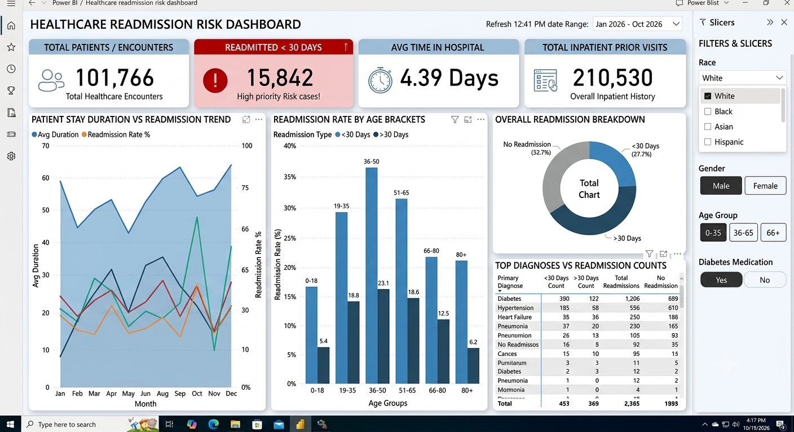

## 📊 Dashboard Preview

---
🏥 Hospital Readmissions Analytics & Risk Prediction
📌 Project Overview
Yeh project ek comprehensive data analysis aur risk prediction solution hai jo hospital readmission patterns ko samajhne ke liye banaya gaya hai. Iska main objective yeh identify karna hai ki kaun se clinical aur demographic factors (jaise patient ki age, hospital me rukne ki avadhi, aur purani medical history) patient ke 30 din ke andar dobara hospital readmit hone ke risk ko sabse zyada badhate hain.

🛠️ Tech Stack & Tools Used
Database & Querying: PostgreSQL, SQL (pgAdmin)

Data Processing & Analysis: Python, Pandas, NumPy

Data Visualization: Seaborn, Matplotlib, Power BI Interactive Dashboard

Version Control: GitHub

📊 Key Visualizations & Exploratory Data Analysis (EDA)
Patient Age Distribution vs Readmission Status:

Is visualization se yeh pata chalta hai ki kis age group ke patients me readmission ka risk sabse high hota hai.

Length of Stay vs Readmission Impact:

Yeh analyze karta hai ki hospital me bitaye gaye dino (Stay Duration) ka patient ke recovery aur dobara admit hone par kya asar padta hai.

Prior Inpatient Visits Impact:

Purane inpatient visits aur emergency records ka 30-din ke readmission rate par kya prabhav padta hai, iska deep dive breakdown.

💡 Key Business Insights
Jin patients ki prior inpatient visits zyada hoti hain, unka high-priority risk category me aane ka chance kafi badh jata hai.

Specific age brackets aur length of stay combinations healthcare providers ko high-risk patients ki pehle se hi pehchan karne me madad karte hain.

🚀 How to Explore This Repository
SQL Queries: Hospital_Readmissions.sql file me data cleaning, duplicate handling aur business analytical queries di gayi hain.

Python Analysis: Jupyter / Colab notebook me Pandas aur Seaborn ka use karke data processing aur charts generate kiye gaye hain.

Dashboard Preview: Power BI dashboard aur Seaborn plots ke visual insights repository me available hain.

* BCA Student | Aspiring Data Analyst
